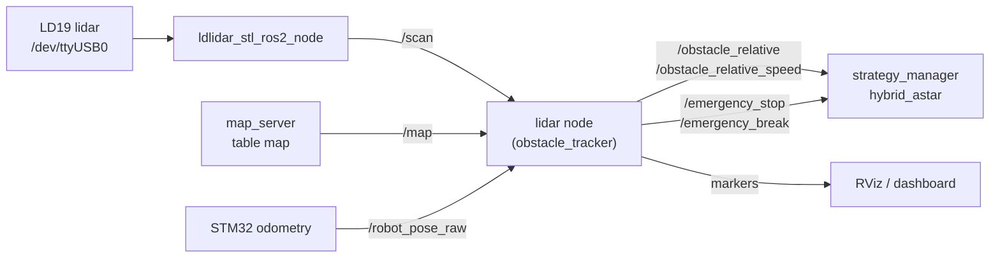

# LIDAR_EUROBOT — opponent detection and collision warning

ROS 2 Jazzy workspace that turns the scans of an **LDROBOT LD19** lidar into what the EUROBOT 2026 robot needs during a match: *where is the opponent, how fast is it moving, and are we about to hit it?*

It runs on the robot's Raspberry Pi next to [ROS2-WS-EURO](https://github.com/Eurobot-2026-Aerobotix/ROS2-WS-EURO). The match brain (`strategy_manager`) subscribes to its outputs to slow down, stop, or re-plan around the opponent.

## How it works



For each scan, the `lidar` node:

1. **Projects** the scan into table coordinates using the robot pose interpolated at the scan's timestamp.
2. **Removes the table** by dropping points that fall on occupied cells of the static map (walls, fixed elements) or outside the table.
3. **Clusters** the remaining points (size limits reject anything that cannot be a robot) and **tracks** one opponent by following the cluster closest to its last position.
4. **Estimates velocities** of both the robot and the opponent from their recent history.
5. **Predicts a collision** by moving the robot (a rectangle) and the opponent (a circle whose radius grows with the closing speed between the two) forward in time and checking for overlap, with hysteresis so the warning does not flicker.
6. **Publishes** the opponent pose and speed, emergency-stop messages, and RViz markers.

## Topics

| Topic | Type | Direction | Content |
|---|---|---|---|
| `/scan` | `sensor_msgs/LaserScan` | in | LD19 scan |
| `/map` | `nav_msgs/OccupancyGrid` | in | Table map (transient-local QoS) |
| `/robot_pose_raw` | `geometry_msgs/Vector3` | in | Robot pose from the STM32 (m, m, rad) |
| `/obstacle_relative` | `geometry_msgs/PoseStamped` | out | Opponent position |
| `/obstacle_relative_speed` | `geometry_msgs/Twist` | out | Opponent velocity |
| `/emergency_stop` | `lidar_obstacle_warning_msgs/EmergencyStop` | out | `emergency_triggered` (int32), `distance` (float32) |
| `/emergency_break` | `std_msgs/Int32` | out | Brake request |
| `/collision_visualization`, `/obstacle_candidate_marker` | `visualization_msgs/Marker` | out | RViz debugging |

The robot footprint, opponent radius, and prediction thresholds are set at the top of `lidar_obstacle_warning_node.py`.

## Packages

| Package | Content |
|---|---|
| `lidar_obstacle_warning` | The `lidar` detection node, a `robot_simulation` pose publisher for testing without the robot, launch files, RViz config |
| `lidar_obstacle_warning_msgs` | `EmergencyStop.msg` (also used by ROS2-WS-EURO) |
| `ldlidar_stl_ros2` | Vendor driver for LD06 / LD19 / STL27L lidars ([upstream](https://github.com/ldrobotSensorTeam/ldlidar_stl_ros2)) |
| `euro_ros_map` | Table map for `map_server` (`V3.pgm`, 1 mm per pixel, 2 × 3 m) |
| `torbag` | URDF and mesh of the competition robot |
| `robot_description` | URDF of an earlier test robot (diffbot) |

## Build

```bash
cd ~
git clone https://github.com/Eurobot-2026-Aerobotix/LIDAR_EUROBOT.git
cd LIDAR_EUROBOT
source /opt/ros/jazzy/setup.bash
rosdep install --from-paths src --ignore-src -r -y
colcon build --symlink-install
source install/setup.bash
```

Clone it into your home directory: `robot_only.launch.py` loads the URDF and map from `~/LIDAR_EUROBOT/src/...`.

Give your user access to the lidar's serial port (or install the vendor udev rule with `src/ldlidar_stl_ros2/scripts/create_udev_rules.sh`):

```bash
sudo usermod -aG dialout $USER
```

## Run

**On the robot** (this is what the dashboard's *Prepare Robot* button starts):

```bash
ros2 launch lidar_obstacle_warning robot_only.launch.py
```

It starts the LD19 driver, the `base_link → base_laser` transform, `robot_state_publisher`, `map_server`, and the `lidar` node.

**Visualise from a laptop** on the same network and `ROS_DOMAIN_ID`:

```bash
ros2 launch lidar_obstacle_warning rviz_remote.launch.py
```

**Lidar only** (check that the sensor works):

```bash
ros2 launch ldlidar_stl_ros2 viewer_ld19.launch.py
```

**Without the robot:** run `ros2 run lidar_obstacle_warning robot_simulation` to publish a fake `/robot_pose_raw`.

## Configuration

| What | Where |
|---|---|
| Lidar serial port and frame | `src/ldlidar_stl_ros2/launch/ld19.launch.py` (`/dev/ttyUSB0`, `base_laser`) |
| Lidar mounting height / offset | `static_transform_publisher` in `robot_only.launch.py` |
| Table map | `src/euro_ros_map/map.yaml` |
| Detection and collision thresholds | `lidar_obstacle_warning_node.py` |
