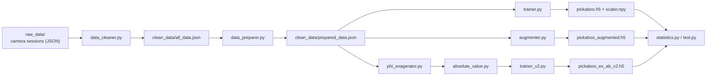
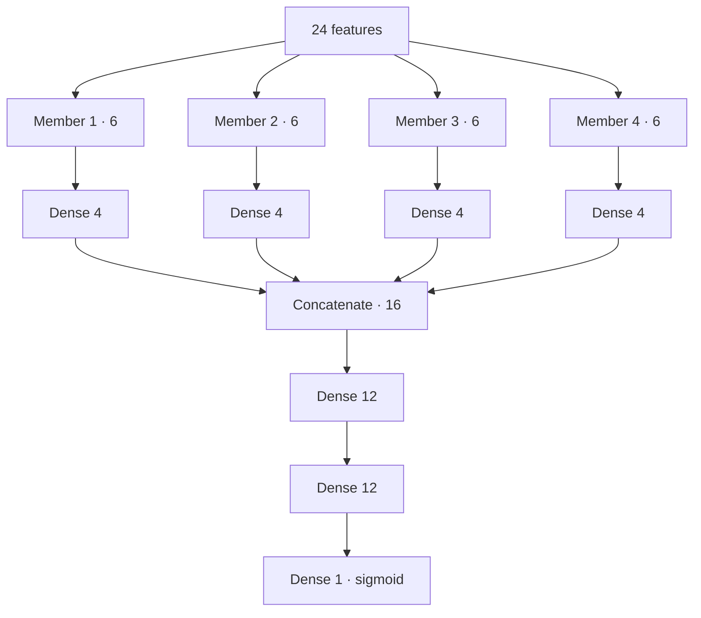

# Pickaboo — can the robot pick this batch?

A small neural network that predicts whether a **batch** of game elements on the EUROBOT 2026 table can be picked up by AEROBOTIX INSAT's robot.

The overhead ArUco camera (beacon) sees each game element as a tag with a position and an orientation. Elements that lie together form a batch of up to four members. Whether the robot's grippers can take a batch depends mostly on each element's **deviation**, the angle between the element and its known fixed pose (`fx_poses.json`). Pickaboo learns that decision from recorded camera data.

> **Status:** experiment. The competition stack ([ROS2-WS-EURO](https://github.com/Eurobot-2026-Aerobotix/ROS2-WS-EURO)) does not load this model.

## Results

On the held-out test set (`pickaboo.h5`, see [`statistics_report.md`](statistics_report.md)):

| Metric | Value |
|---|---|
| Accuracy | 99.7 % |
| Precision | 99.8 % |
| Recall | 99.7 % |
| ROC AUC | 0.9999 |
| Confusion matrix | `[[1324, 4], [7, 2186]]` |

Permutation importance shows that **deviation** carries most of the signal, ahead of the y and z positions.

## Pipeline



| Script | Input → output | What it does |
|---|---|---|
| `data_cleaner.py` | `raw_data/` → `clean_data/all_data.json` | Turns raw camera-session files into labelled batches |
| `data_preparer.py` | → `clean_data/prepared_data.json` | Normalises batches into the training format (below) |
| `trainer.py` | → `pickaboo.h5`, `scaler.npy` | Trains the base model |
| `augmenter.py` | → `clean_data/augmented_data.json` | Adds variants by offsetting member positions and deviations |
| `phi_exagerator.py` | → `clean_data/exagerated_data.json` | Pushes deviations away from zero to separate the two classes more clearly |
| `absolute_value.py` | → `clean_data/exagerated_absolute_data.json` | Replaces deviations with their absolute value |
| `trainer_v2.py` | → `pickaboo_ex_ab_v2.h5` | Trains the v2 architecture (below) on the exaggerated, absolute data |
| `statistics.py` | → `statistics_report.md` / `.json` | Test metrics and permutation feature importance |
| `raw_to_samples.py` | `raw_data/test/` → `test_samples.json` | Builds test samples from raw sessions, using the fixed batch poses in `fx_poses.json` |
| `test.py` | `test_samples.json` | Compares all saved models on the same samples |

## Data format

`clean_data/prepared_data.json` is a list of batches:

```json
{
  "batch_id": 1,
  "members": [
    { "x": 0.035, "y": -0.017, "z": 0.059, "deviation": 32.851, "blue": false }
  ],
  "pickable": true,
  "cam_distance": 2.062
}
```

Each batch becomes a **24-value feature vector**, six values per member, for four members:

`x`, `y`, `z`, `deviation`, `blue` (1.0 / 0.0), `cam_distance`

The output is a probability in `[0, 1]`. `≥ 0.5` means pickable.

## Models

**v1 (`trainer.py`).** Each member's six features go through their own `Dense(4, ReLU)` branch. The four branches are concatenated, then pass through `Dense(12)` → `Dense(12)` → `Dense(1, sigmoid)`.



**v2 (`trainer_v2.py`).** Same network, but the four raw `deviation` inputs (indices 3, 9, 15, 21) are also concatenated with the last hidden layer. This gives deviation a direct path to the output.

Training uses a shuffled 80 / 10 / 10 train / validation / test split, `StandardScaler`, and binary cross-entropy.

Model files, from the commit history:

| File | Notes |
|---|---|
| `pickaboo.h5` | First model, prepared data, v1 (99.4 % test accuracy at the time) |
| `pickaboo_augmented.h5` | v1 trained on the augmented dataset |
| `pickaboo_exagerated.h5` | v1 trained on exaggerated deviations |
| `pickaboo_v2.h5`, `pickaboo_exagerated_v2.h5` | v2. `pickaboo_exagerated_v2.h5` was marked "best model yet, tested by hand" |
| `pickaboo_ex_ab_v2.h5` | Latest: v2 on exaggerated + absolute deviations. **Feed it absolute deviation values.** |

The input and output files of `trainer.py` and `trainer_v2.py` are set by the `PREPARED_DATA_FILE` and `MODEL_FILE` constants at the top of each script. Edit them to choose which dataset to train on and where to save the model.

## Run

```bash
python -m venv .venv
source .venv/bin/activate          # Windows: .venv\Scripts\activate
pip install tensorflow scikit-learn numpy

python data_cleaner.py          # needs the raw session files in raw_data/ (not in the repository)
python data_preparer.py
python trainer.py
python statistics.py
```

At inference time, apply `scaler.npy` and keep the same feature order as in training.
