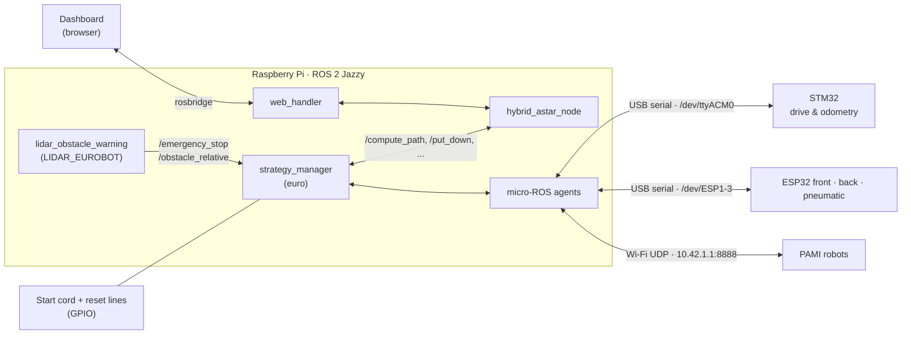

# EUROBOT 2026 — ROS 2 Workspace

The onboard software of AEROBOTIX INSAT's main robot for **EUROBOT 2026**. It runs on a Raspberry Pi with **ROS 2 Jazzy** and decides what the robot does during a 100-second match: it loads a strategy, plans collision-free paths, sends motion commands to the STM32 drive controller, drives the front/back/pneumatic mechanisms on ESP32 boards, and reacts to the opponent seen by the lidar.

🥇 1st — Tunisian qualifications · 🥈 2nd — international accumulation phase · 🌍 5th — EUROBOT 2026 finals

[Robot demo ↗](https://www.youtube.com/watch?v=EC6gGIbOj7o&list=PLNhKoU2ZKSAGotMFKrfqBCY1hgt4LfQE8) · [Operator dashboard ↗](https://github.com/Eurobot-2026-Aerobotix/Eurobot_Dashboard) · [Lidar stack ↗](https://github.com/Eurobot-2026-Aerobotix/LIDAR_EUROBOT)

## How the robot is wired



- **STM32** ([Navigation_MicroROS_2026](https://github.com/Eurobot-2026-Aerobotix/Navigation_MicroROS_2026)) handles motors, odometry, and trajectory following. It exposes one service, `/stm/navi_stm`.
- **ESP32 boards** ([front](https://github.com/Eurobot-2026-Aerobotix/System_code_ESP32_front), [back](https://github.com/Eurobot-2026-Aerobotix/System_code_ESP32_back), [pneumatic](https://github.com/Eurobot-2026-Aerobotix/System_Code_ESP32_pneumatic)) drive the pick-up mechanisms.
- **PAMIs** ([PAMI_ESP32_code](https://github.com/Eurobot-2026-Aerobotix/PAMI_ESP32_code)) are small autonomous robots that receive their strategy over Wi-Fi.
- The Pi's **GPIO** reads the start cord (*tirette*) and can hard-reset the STM32 and each ESP32 before a match.

## Packages

| Package | Type | What it does |
|---|---|---|
| [`euro`](src/euro) | ament_python | Match brain: strategy loading, task scheduling, decision making, and one controller node per device |
| [`hybrid_astar`](src/hybrid_astar) | ament_cmake (Python nodes + interfaces) | Hybrid A* planner, live map of game elements and opponents, and the bridge node for the web dashboard |
| [`aruco_mapper_msgs`](src/aruco_mapper_msgs) | interfaces | Messages from the ArUco beacon camera: tracks, batches of game elements, stable detections |
| [`service`](src/service) | interfaces | `NaviStm.srv`, the command channel to the STM32 |
| [`rviz`](src/rviz) | ament_cmake | Table map, robot URDF, map server, and RViz configuration |

### `euro` — strategy and orchestration

`ros2 run euro strategy_manager` starts **one process** that spins several nodes on a `MultiThreadedExecutor`:

| Node / module | Role |
|---|---|
| `StrategyManager` | Loads the selected YAML strategy, splits it into per-device queues (`STM`, `ESP_front`, `ESP_back`, `RASP_PI`, `PAMI`), publishes `/web/task_scheduler_status` |
| `TaskScheduler` + `DecisionMaker` | Picks the next objective from the live map, handles re-planning, opponent steals, safety obstacles, and return-home before time runs out |
| `PathfinderClient` | Client for every `hybrid_astar` service (`/compute_path`, `/put_down`, `/delete_batch`, `/set_team_color`, ...) |
| `STM32Controller` | Encodes motion commands into `/stm/navi_stm` requests |
| `FrontSystemsController` / `BackSystemsController` | Publish `/front/*` and `/back/*` actuator commands (`n20`, `kabech`, `dawer`) and poll `/front/isIDLE`, `/back/isIDLE` |
| `PneumaticController` | Publishes `/front/pneumatic` and `/back/pneumatic` |
| `Lidar` | Subscribes to `/emergency_stop`, `/obstacle_relative`, and `/robot_pose_raw` |
| `RPiController` | Start-cord button and active-low reset lines for the STM32 and ESP32 boards (falls back to simulation off-Pi) |

Worker threads in `strategy_executor.py` (`stm32_task`, `front_task`, `back_task`, `path_planning_task`, `lidar_status`, `task_tracking_task`, ...) consume the queues in parallel. The 100-second round timer is shared through `shared_state.py`.

Other executables: `pami_controller`, `pami_test_manager` (send and test PAMI strategies), `stm32_agent`, and `esp32_agents` (start micro-ROS agents in tmux).

### `hybrid_astar` — planning and the live map

| Executable | Role |
|---|---|
| `hybrid_astar_node.py` | Orientation-aware Hybrid A* on a 2000 × 3000 mm table (15 mm grid), with robot footprint, safety margin, and path smoothing. Serves `/compute_path`, `/update_map`, `/clear_map`, `/reset_map`, `/start_game`, `/put_down`, `/delete_batch`, `/set_team_color`, `/get_active_batches`, `/get_batch_color_pattern`. Publishes `/active_obstacles`, `/obstacles/current`, `/path_visualization`. |
| `web_handler.py` | Bridge for the dashboard: listens on `/web/*` String topics (JSON), converts units (mm → m, degrees → quaternions), calls the planner, and answers on `/web/*_result` |
| `json_to_ros.py`, `yaml_to_ros.py`, `generate_path.py` | Offline tools: replay a map or strategy file into the planner, or pre-compute paths |

Planner parameters live in [`src/hybrid_astar/config/hybrid_astar_params.yaml`](src/hybrid_astar/config/hybrid_astar_params.yaml).

## Strategy files

A strategy is a YAML list of tasks. Each task holds an optional global goal and a sequence of device commands:

```yaml
name: first_test
color: yellow
tasks:
- description: Task 2
  global_goal: {x: '1006.47', y: '787.73', theta: 0}
  sequence:
  - device: STM
    command: bezier            # x1 y1 x2 y2 x3 y3 speed
    params: ['845.86', '285.52', '996.27', '418.08', '1006.47', '787.73', 700]
    wait: true
  - device: STM
    command: orientate
    params: [0]
    wait: true
```

| Device | Commands |
|---|---|
| `STM` | `set_position`, `go_to`, `go_to_backwards`, `bezier`, `bezier_backwards`, `move_forward`, `rotate`, `orientate`, `creep`, `creep_to`, `creep_backwards`, `creep_to_backwards` |
| `ESP_front` / `ESP_back` | `prepare`, `unprepare`, `pick_up`, `pick_up_fx`, `put_down` |

Examples are in [`src/euro/config`](src/euro/config). Match strategies are usually edited and selected from the [dashboard](https://github.com/Eurobot-2026-Aerobotix/Eurobot_Dashboard).

### STM32 commands

`STM32Controller` turns each `STM` command into a `/stm/navi_stm` request (`NaviStm.srv`: ten floats, `arg1` = command ID). The command IDs the firmware accepts are listed in the [Navigation_MicroROS_2026 README](https://github.com/Eurobot-2026-Aerobotix/Navigation_MicroROS_2026#stmnavi_stm-commands).

## Build

Requirements: Ubuntu 24.04, ROS 2 Jazzy, `colcon`, `rosdep`, and the [`micro_ros_agent`](https://github.com/micro-ROS/micro-ROS-Agent) package for hardware runs.

```bash
mkdir -p ~/ros2_ws && cd ~/ros2_ws
git clone https://github.com/Eurobot-2026-Aerobotix/ROS2-WS-EURO.git
git clone https://github.com/Eurobot-2026-Aerobotix/LIDAR_EUROBOT.git   # provides lidar_obstacle_warning_msgs

source /opt/ros/jazzy/setup.bash
cd LIDAR_EUROBOT && colcon build && source install/setup.bash && cd ..
cd ROS2-WS-EURO
rosdep install --from-paths src --ignore-src -r -y
colcon build --symlink-install
source install/setup.bash
```

## Run

On the robot, the [dashboard](https://github.com/Eurobot-2026-Aerobotix/Eurobot_Dashboard) starts these for you. To run them by hand:

```bash
# 1. micro-ROS agents (STM32 + three ESP32 over serial; PAMIs over UDP)
ros2 run euro stm32_agent
ros2 run euro esp32_agents

# 2. Planner + dashboard bridge
ros2 launch hybrid_astar hybrid_astar.launch.py

# 3. rosbridge, for the dashboard
ros2 launch rosbridge_server rosbridge_websocket_launch.xml

# 4. Match brain (waits for the STM32 service, then for the start cord)
ros2 run euro strategy_manager

# Optional: visualise the table and robot pose
ros2 launch rviz rviz.launch.py
```

Before connecting to hardware, check the serial device names (`/dev/ttyACM0`, `/dev/ESP1`-`/dev/ESP3` come from udev rules on the robot), the team color, and the selected strategy.

## Repository layout

```text
src/
├── euro/                 # strategy_manager and device controllers
│   ├── config/           # example strategy YAML files
│   └── euro/
├── hybrid_astar/         # planner, map manager, web_handler, interfaces
│   ├── config/hybrid_astar_params.yaml
│   ├── launch/hybrid_astar.launch.py
│   ├── msg/ srv/
│   └── hybrid_astar/
├── aruco_mapper_msgs/    # beacon-camera interfaces
├── service/              # NaviStm.srv
└── rviz/                 # map, URDF, RViz config
```

## Safety

This code moves a real robot. Test with the wheels off the ground first, keep the emergency stop within reach, and confirm the team color and strategy before every match.

## Team

Built by AEROBOTIX INSAT for EUROBOT 2026. See the commit history for individual contributions.
