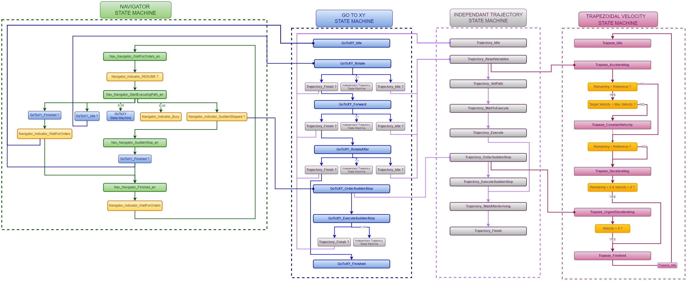

# 3. Navigation State Machine Structure

The STM32 navigation firmware is organized as **four nested state machines**, each owning a different level of abstraction.

```
Navigator State Machine        (CAN-facing, high-level control flow)
   └── GoToXY State Machine        (Point-to-point navigation)
        └── Independent Trajectory State Machine   (Single-axis move: one rotation or one straight line)
             └── Trapezoidal Velocity State Machine   (Velocity profile execution, see Section 4)
```



---

## 3.1 Navigator State Machine

This layer was restructured from its original form. It now has **four states** instead of the earlier eight-plus-status-flags model, with CAN-facing status split out into separate **Indicator** flags rather than being baked into the state enum itself.

| State | Behavior | Exits to |
|---|---|---|
| `Nav_Navigator_WaitForOrders_en` | Idle, waiting for the Pi to signal it's ready to resume/dispatch. Checks `Navigator_Indicator_RESUME?`. | `Nav_Navigator_StartExecutingPath_en` once resume is confirmed. |
| `Nav_Navigator_StartExecutingPath_en` | Drives the GoToXY state machine every tick. Each tick checks: is GoToXY still idle (not yet kicked off)? still running (drive it, set `Navigator_Indicator_Busy`)? or `GoToXY_Finished?` — and separately watches `Navigator_Indicator_SuddenStopped?` on every pass. | Back to `Nav_Navigator_WaitForOrders_en` (via `Navigator_Indicator_WaitForOrders`) on normal completion; to `Nav_Navigator_SuddenStop_en` if a sudden-stop was requested mid-move. |
| `Nav_Navigator_SuddenStop_en` | Keeps driving the GoToXY machine (now itself mid sudden-stop sequence) until `GoToXY_Finished?` reports true. | `Nav_Navigator_Finished_en`. |
| `Nav_Navigator_Finished_en` | Terminal state for a sudden-stop-aborted move. Sets `Navigator_Indicator_WaitForOrders`. | Back to `Nav_Navigator_WaitForOrders_en`. |

**Indicator flags** (`Navigator_Indicator_RESUME`, `Navigator_Indicator_Busy`, `Navigator_Indicator_SuddenStopped`, `Navigator_Indicator_WaitForOrders`) are set and checked alongside these four states rather than being separate states themselves. They're what actually gets exposed to the Raspberry Pi over CAN as navigation status.

