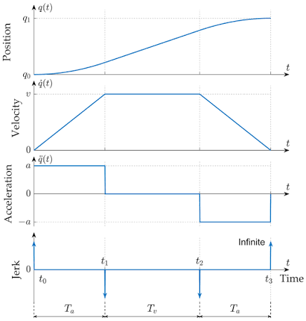
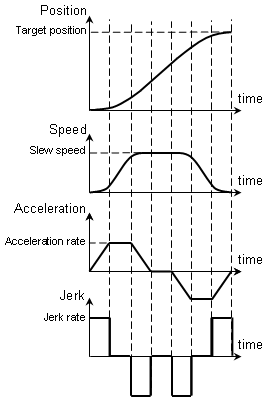

# 4. Motion Profiling (Trapezoidal vs. S-Curve)

Both profile generators live in `NavStateMachineTest.c` and are called from `Nav_Trajectory_Execute_en` once per 5 ms control tick to produce the next target velocity. Only one runs in production at a time — `Nav_TrapezeLinearVelocity2()` is currently active; the `S_CurveLinearVelocity()` call is commented out.

---
 ### Ressources to read:

https://www.pm-robotix.eu/2022/02/02/asservissement-et-pilotage-de-robot-autonome/: read the section "Génération de trajectoire" 

## 4.1 Trapezoidal profile (The currently used profile)


Three phases: accelerate at a constant rate, cruise at max velocity, decelerate at a constant rate. 

**Accelerating phase.** Every tick, the code computes a reference stopping distance — how far the robot would need to decelerate from the current target velocity at rate `Nav_Acc_d`:

```
Nav_ReferenceDistance_d = TargetVelocity² / (2 · Nav_Acc_d)
```

This is the standard `v² = 2·a·d` relation, solved for distance. As long as the remaining distance to the target is still larger than that reference distance, it's safe to keep accelerating:

```
if RemainingDistance > ReferenceDistance:
    if TargetVelocity < MaxVelocity:
        TargetVelocity = Nav_Acc_d × Nav_CurrentSample_u32   // linear ramp: v = a·t
    else:
        → ConstantVelocity phase
else:
    → Decelerating phase directly (target is too close to reach MaxVelocity)
```

`Nav_CurrentSample_u32` is the tick counter since the move started, so `Nav_Acc_d × Nav_CurrentSample_u32` is just `v = a·t` — velocity ramps up linearly with elapsed ticks.

**Constant velocity phase.** Holds `TargetVelocity = Nav_MaxVelocity_d` and re-checks the same `ReferenceDistance` test every tick. The moment the remaining distance drops to what's needed to decelerate to zero, it switches to `Decelerating` and snapshots the current tick count (`Nav_AccelerationSamples_u32`) and current velocity (`Nav_ReferenceLinearVelocity_d`) as the starting point for the ramp-down.

**Decelerating phase.** Symmetric linear ramp-down from the snapshotted velocity:

```
TargetVelocity = ReferenceLinearVelocity − Nav_Acc_d × (CurrentSample − AccelerationSamples)
```

The move ends (→ `Finished`) when either the remaining distance hits zero or the velocity decays below a small threshold (`0.03`), whichever comes first — this catches both "arrived exactly" and "numerically settled to a stop" cases.


---

## 4.2 S-curve (jerk-limited) profile

Seven phases instead of three — acceleration itself ramps up and down smoothly instead of switching on/off instantly, which is what removes the "kink" at the top and bottom of the trapezoidal ramp . This trades a longer profile for less mechanical shock and less wheel slip.




**Phase map** (`Nav_SCurve_Phase_u8`, in `S_CurveLinearVelocity()`):

| Phase | Name | What happens |
|---|---|---|
| 1 | Jerk up | Acceleration ramps `0 → A_max` at rate `Nav_Jerk_d`; velocity grows quadratically. |
| 2 | Constant accel | Acceleration holds at `A_max`; velocity grows linearly. |
| 3 | Jerk down | Acceleration ramps `A_max → 0`; velocity keeps growing but the rate tapers off, arriving at `V_max` with zero acceleration (no overshoot). |
| 4 | Cruise | Constant velocity at `V_max`. |
| 5 | Jerk down (decel) | Mirror of phase 1: deceleration ramps `0 → −A_max`. |
| 6 | Constant decel | Mirror of phase 2: holds at `−A_max`. |
| 7 | Jerk up (decel) | Mirror of phase 3: deceleration ramps back to `0` exactly as velocity reaches zero. |

**The key constant** used to decide phase transitions is the velocity gained (or lost) over one full jerk ramp, at constant jerk `Nav_Jerk_d` up to `A_max`:

```
vel_per_jerk_phase = A_max² / (2 · Nav_Jerk_d)
```

This comes from integrating `a(t) = J·t` twice: distance under the acceleration curve during a jerk ramp works out to `A_max²/(2J)`. The code uses this in two ways:

- **Deciding whether phase 2 (constant accel) exists at all.** In phase 1, once acceleration reaches `A_max`, the code checks how much velocity is still needed to reach `V_max`:
  ```
  vel_remaining = V_max − TargetVelocity
  if vel_remaining <= vel_per_jerk_phase + A_max:
      skip straight to phase 3   // not enough runway for a constant-accel segment
  else:
      → phase 2
  ```
- **The "triangle" case** — if `V_max` itself is small enough that acceleration never reaches `A_max` before velocity would overshoot, phase 1 jumps straight to phase 3 at the `V_max / 2` midpoint, producing a triangular (not trapezoidal) acceleration profile. This mirrors the same corner case a trapezoidal profile hits when the target is too close to ever reach cruise speed.

**When to start decelerating (phase 4 → phase 5)** uses a distance formula that extends the trapezoidal `v²/2a` term with an S-curve correction for the extra distance covered during the jerk ramps:

```
D_decel = V_max² / (2 · A_max)   +   V_max · A_max / (2 · Nav_Jerk_d)
          └── trapezoidal term ──┘   └── S-curve jerk correction ──┘
```

Deceleration (phases 5–7) is the mirror image of acceleration (phases 1–3), using the same `vel_per_jerk_phase` constant to decide whether phase 6 (constant decel) is skipped, and finishing when velocity settles to zero in phase 7.

---

