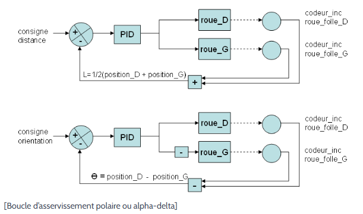
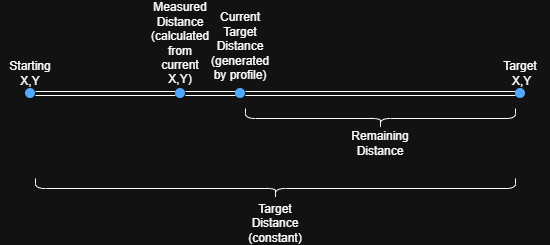
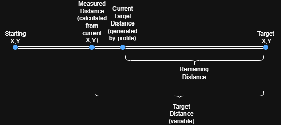
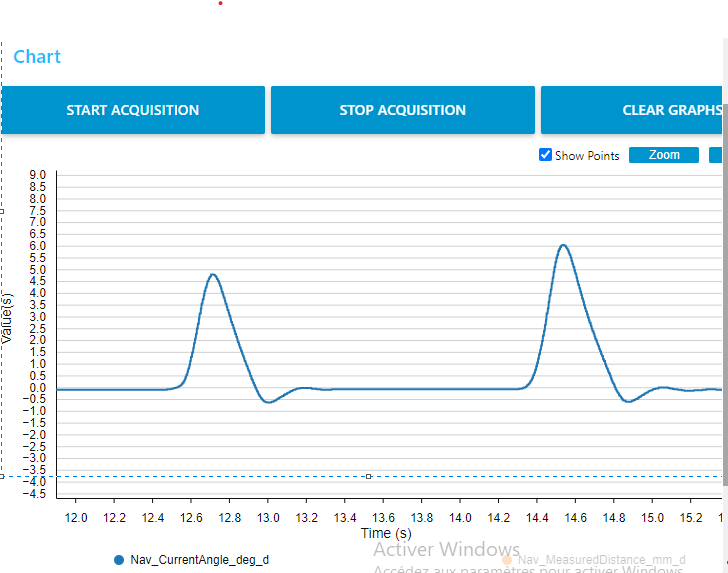
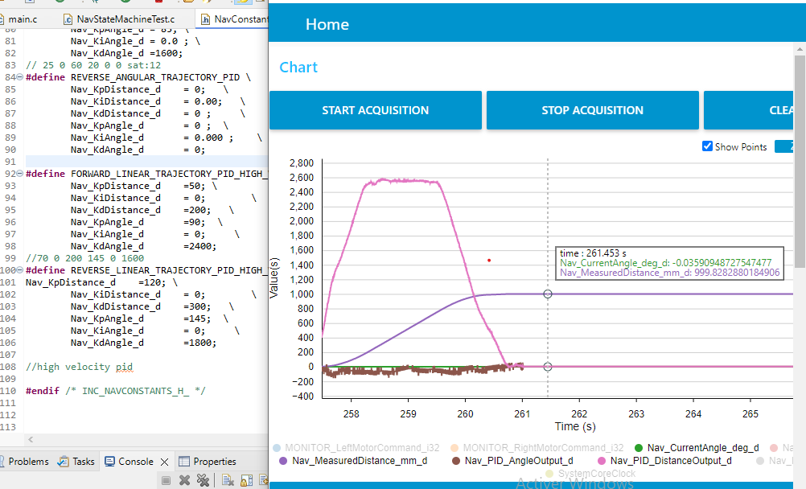

# 6. Dual-Loop PID Control System

### Ressources to read:
https://www.rcva.fr/cours-asservissement/: An introduction to the two principles of pid correction depending on a trajectory

https://www.rcva.fr/10-ans-dexperience/9/ : a more practical guide into pid (read the answer to the last question in the questions in 10 ans d'expérience it contains their tuning method and it's the same one we're using)

https://www.pm-robotix.eu/2022/01/19/ameliorer-vos-regulateurs-pid/ :This article is FIRE.It talks about different PID problems and how to solve them like derivative kick,integral wind_up...You can also check Brian Douglas matlab playlist about pid.

https://www.pm-robotix.eu/2022/12/07/instancier-regler-asservissement-robot-autonome/ 

--- 

### Polar PID:



This is a classic polar PID scheme for differential-drive robots. The name comes from how the error is expressed: instead of controlling each wheel independently, the robot's error to target is decomposed into two orthogonal polar components — a distance error (how far away, in a straight line) and an angle error (how much heading correction is needed) — each closed by its own independent PID loop, then mixed back into the two wheels.

---
# Before PID tuning :

The first step before doing anything is to make sure the stm32 is correctly reading the encoders ticks(+they don't block at all in one value when you move the wheels) and in the right direction.Also,you need to make sure both motors work correctly and that the right/left motors are set correctly.

To do this comment out everything in HAL_TIM_PeriodElapsedCallback function in main.c and only leave Nav_vFeedbackRoutine which is the function that handles encoder ticks and odometry.also in the while(1) loop remove comments on this part 
```
    MOTOR_PWM->RIGHT_FORWARD = test1;
    MOTOR_PWM->RIGHT_REVERSE = test2;
    MOTOR_PWM->LEFT_FORWARD = test3;
    MOTOR_PWM->LEFT_REVERSE = test4 ;     
```
Then enter debug mode,open live expressions and put these variables to view:

- **test1,test2,test3,test4** :put the wheels in the air and give a high command(above 800) to see if the motors are even responding.Then if the right motor and the left one are swapped or/and the rotating direction of each motor is inversed just go into NavConfig.h and swap the timers.

- **Nav_RightTicks_i32,Nav_LeftTicks_i32**:encoder ticks
### Minimum commands
Once everything is confirmed to be working and is in the right correction,you need to find the different minimum commands .These commands are set in NavConstants.h ,you'll find MINIMUM_COMMANDS_WITH_PLATFORMS and MINIMUM_COMMANDS_WITHOUT_PLATFORMS; when the robot is activating its mecanism and picking up something for example platforms,it weights a bit more so you may find that the minimum commands you've set without platforms are no longer enough to move the robot.

To set these values,put the robot on the map,keep test1,test2,test3,test4 in live expressions and for every variable start by a low value(300 for exp) and start increasing until the robot moves and does a full circle without stopping(Try to avoid putting debugging cable tension on the robot).

**Be careful not to set the minimum commands way too high** : Doing so can cause the robot to oscillate when approaching its destination. For instance, if the robot is only a few millimeters away from its target, the error is very small, which naturally results in a low PID output. If this output falls below the minimum command threshold, it gets saturated to minimum commands. Instead of making smooth, subtle adjustments to eliminate the remaining error, the robot will move too aggressively, overshooting its goal and potentially getting stuck in a continuous loop of overcorrections.

**Also be careful not to set the minimum commands too low**: Doing so can cause the robot to enter the wait_to_reach state frequently so it never reaches its destination.

Once everything is set ,recomment everything in while(1) loop and only call **Nav_vTestPathStateMachine()** function (tuning function) in the callback function.

### Understanding the difference between the tuning code and the code that actually runs with the raspberry:
Two things change between the standalone bench-tuning path (`Nav_vTestPathStateMachine`) and the production path driven by the Pi: how **remaining distance** is computed, and whether the **target angle** is static or dynamic. Both differences exist for the same reason — tuning needs a fixed, repeatable reference so the person tuning is only looking at the PID/profile response, not extra dynamic behavior layered on top of it.

### Remaining distance: fixed target vs. re-derived target


What differs is where `Nav_TargetDistance_mm_d` comes from.

**During tuning**, `Nav_TargetDistance_mm_d` is a constant set once at the start of the move (exp `Nav_TargetDistance_mm_d = 1000` in `Nav_vTestPathStateMachine`). Remaining distance only shrinks because `Nav_CurrentTargetDistance_mm_d` (the profile's own generated position )advances. It has no dependency on where the robot actually is:



**In production**, `Nav_TargetDistance_mm_d` is recomputed on every tick, directly from the robot's measured position:

```
Nav_TargetDistance_mm_d = sqrt( (Nav_TargetX_mm_d − Nav_CurrentX_mm_d)² + (Nav_TargetY_mm_d − Nav_CurrentY_mm_d)² )
```

`Nav_CurrentX_mm_d` / `Nav_CurrentY_mm_d` come from live odometry, so remaining distance now reflects real deviation between where the robot actually is and where it should be — not just how far the profile has generated so far:



### Static vs. dynamic target angle

While tuning, the target angle is held at a constant `Nav_TargetAngle_deg_d = 0` for the whole move. In production, `Nav_CurrentTargetAngle_deg_d` is continuously re-aimed at the real target via `Nav_vCurrentTargetAngleFollower()`:

```
Nav_CurrentTargetAngle_deg_d = atan2(Nav_TargetY_mm_d − Nav_CurrentTargetY_mm_d, Nav_TargetX_mm_d − Nav_CurrentTargetX_mm_d)
```


**To understand the purpose of the dynamic target angle**: with a constant target angle, the heading PID can correct the robot back to *parallel* to the original line, but not necessarily back *onto* it — if the PID isn't fast enough to fully cancel a heading error before the profile keeps advancing, the robot ends up tracking a path offset from the intended one. With a dynamic target angle, the aim point itself continuously points at the real target, so any lateral drift automatically steepens the corrective angle and pulls the robot back onto the original line, not just onto a parallel one.

The reason for keeping tuning static is the same reason as above: a fixed reference isolates the PID/profile response from this extra re-aiming behavior, so gains can be tuned against a known, repeatable signal.

# Tuning the PD Controller

Take a look at this video to get an idea on the tuning process: https://www.youtube.com/watch?v=fN1aoqDqjAo 


We are using a **PD controller** for this system. The reason for this choice is that the proportional gain KP alone provided an exceptionally low steady-state error. In testing, adding ki only introduced instability and unwanted oscillations. 

>  **Note:** Feel free to use a PID controller or any other controller if it's more reliable in this case.

---

## 1. Initial Setup 

To set up the test environment, you must switch from the running code to the tuning code:

Replace `Nav_vIndependantTrajectoryStateMachine` in `NavStateMachineTest.c` with the second version of the same function found in `CalibratingFunctions.c`.

**Why?** This changes how the remaining distance and target distance are calculated, and it comments out any dynamic target angle calculations required during normal operation.

---

## 2. Tuning Linear Motion (`FORWARD_LINEAR_TRAJECTORY`)

**Tuning parameters:** Kp_angle ,Kd_angle, Kp_distance ,Kd_distance in FORWARD_LINEAR_TRAJECTORY  in NavConstants.h

### Step 2.1: Tune Angle PID (`pid_angle`)
Before moving the robot forward, we need to ensure it can maintain its heading which is why we're starting with pid_angle.


1. **Configure initial test state:**
   * Set the idle state `Nav_TestPathState_en` to `Nav_Test_Forward_1000mm_en`.
   * Set `Nav_TargetDistance_mm_d = 0` (we are isolating angle tuning first).
2. **Monitor variables:** In **STM32CubeMonitor**, plot `Nav_CurrentAngle_deg_d`.
3. **Tune Kp_Angle:**
   * Gradually increase Kp_Angle in steps of **+5**.
   * Manually displace the robot by 4 to 5 degrees to observe its recovery.
   * **Target:** Stop when steady-state error is < 0.1 deg with max 3 to 4 oscillations before settling.
   * **Safety Warning:** Do not push K_p deep into a fully unstable/oscillatory regime. If the system begins to  oscillate continuously , immediately cut power and reduce K_p.
4. **Tune Kd_Angle:**
   * Slowly increase Kd_Angle (start with small increments; make larger jumps if no effect is visible) until oscillations disappear and overshoot is minimized.



---

### Step 2.2: Tune Distance PID (`pid_distance`)
0. In `main.c`, ensure you **uncomment the 5-second delay** placed directly before the `while(1)` main loop.

 **Why this is necessary:**
 Immediately after flashing the code onto the microcontroller, the state machine and trapezoidal profile counters begin incrementing right away. If you switch on the robot's power after this initialization phase, the target distance will already be far ahead of the current distance, causing the robot to jerk forward violently to catch up. 
 
 The 5-second delay creates a safe startup window—allowing you to power on the robot's motor drivers *before* the delay expires and trajectory execution begins.
1. **Configure motion parameters:** Inside the `Nav_Test_Forward_1000mm_en` case, set:
   * `Nav_TargetDistance_mm_d = 1000`
   * `Nav_MaxVelocity_d = 300`
   * `Nav_Acc_d = 300`
2. **Monitor variables:** Plot the following in **STM32CubeMonitor**:
   * `Nav_CurrentAngle_deg_d`
   * `Nav_MeasuredDistance_mm_d`
   * `Nav_PID_AngleOutput_d`
   * `Nav_PID_DistanceOutput_d`
3. **Set Initial Kp_distance:** Increase Kp_distance (in steps of **+5**) until you see an oscillatory trapezoidal profile in `Nav_PID_DistanceOutput_d`. Ensure `Nav_PID_AngleOutput_d` stays low ideally **below 200** throughout the trajectory and the final position error is < 0.3mm.
4. **Set Kp_distance:** Increase Kp_distance until the trapezoid profile smooths out and all oscillations during movement are eliminated.
5. **Optimize Speed & Acceleration:**
   * **Increase Velocity:** Raise `Nav_MaxVelocity_d` (in steps of **+30**) until the velocity profile changes from a trapezoid to a triangle (meaning it no longer reaches cruise speed).
   * **Increase Acceleration:** Raise `Nav_Acc_d` until the trapezoid shape returns.
   * **Re-verify:** Check if the PID parameters still yield clean behavior.Tune Kp_distance and kd_distance slightly if needed.
   * **Iterate:** Repeat this speed/acceleration loop until you reach the maximum speed where the PID can no longer stabilize the robot.



---

## 3. Tuning Reverse Motion (`REVERSE_LINEAR_TRAJECTORY_PID`)

Repeat the exact process outlined in **Section 2** for `REVERSE_LINEAR_TRAJECTORY_PID`.

---

## 4. Tuning Angular Motion (`FORWARD_ANGULAR_TRAJECTORY_PID`)

Now we tune the robot's rotational movements.

### Step 4.1: Tune Distance PID (`pid_distance`)
we need to ensure the robot does not drift linearly while rotating hence why we're starting with pid_distance.

1. **Configure initial test state:**
   * Set `Nav_TestPathState_en` to `Nav_Test_Rotate_360deg_en`.
   * Set `Nav_TargetAngle_deg_d = 0` (isolating distance/linear drift).
2. **Monitor variables:** Plot `Nav_MeasuredDistance_mm_d` in **STM32CubeMonitor**.
3. **Tune Kp_distance:**
   * Slowly increase Kp_distance (steps of **+5**).
   * Manually push/displace the robot linearly by 5 to 20mm each time to test rejection.
   * **Target:** Stop when static error is < 0.1 with max 3 to 4 oscillations before settling.
4. **Tune Kd_distance:**
   * Increase Kp_distance until oscillations subside and overshoot is minimal. The plot should resemble the step response achieved during the linear angle tuning phase.

---

### Step 4.2: Tune Angle PID (`pid_angle`)
0. uncomment the 5s delay before the while(1) loop.
1. **Configure motion parameters:** Inside the `Nav_Test_Rotate_360deg_en` case, set:
   * `Nav_TargetAngle_deg_d = 360`
   * `Nav_MaxAngularVelocity_d = 70`
   * `Nav_AngularAcc_d = 100`
2. **Set Initial Kp_angle:** Increase Kp_angle (in steps of **+5**) until you observe an oscillatory trapezoidal profile. The final angular error should be ideally<0.2 deg.
3. **Set Kd_angle:** Increase Kd_angle until the trapezoid profile becomes clean and smooth with no rotation oscillations.
4. **Optimize Angular Speed & Acceleration:**
   * **Increase Angular Velocity:** Raise `Nav_MaxAngularVelocity_d` (in steps of **+30**) until the trapezoid degrades into a triangle.
   * **Increase Angular Acceleration:** Raise `Nav_AngularAcc_d` until the trapezoid shape is restored.
   * **Re-verify:** Slightly tune Kd_angle,Kp_angle if higher speeds introduce instability.
   * **Iterate:** Continue this cycle until you reach the system's physical or control limits.

The final output should display a clean velocity trapezoid similar to the one achieved during linear trajectory testing.

**Once your PD controller is tuned ,the next step is to calibrate odometry parameters**


 


